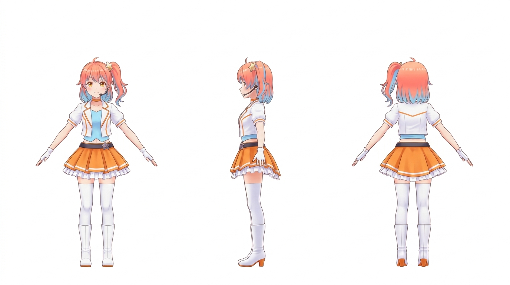

# 日向ミラ(ひなた みら) ─ キャラ設定と VRoid Studio での作り方

オリジナルの元気な歌姫キャラ。設定画: `art/src/gemini/hinata_mira_sheet_v2.jpg`(Gemini で生成)

## プロフィール
- 16歳くらい。いつも笑顔のムードメーカーで、ステージに立つと誰よりも声が通る。
- 口ぐせ「いっくよー!」。好きなものは流れ星と、はちみつ入りの紅茶。
- テーマカラー: アプリコットオレンジ × 水色

## 色の早見表(VRoid の色の入力欄にそのまま貼れます)
| 部分 | 色 |
|---|---|
| 髪(メイン) | `#FF9268`(毛先に向かって少し明るく `#FFB08A`) |
| 髪(インナーカラー) | `#86D9F2` |
| 瞳 | `#F2A93B`(はちみつ色)、ハイライトは白 |
| 肌 | VRoid の標準のまま |
| ジャケット | `#FFFFFF`、ライン `#FF8A3D` |
| 中のトップス | `#8FDCF5` |
| スカート | `#FF8A3D`、裾のライン `#FFFFFF`、フリル `#FFFFFF` |
| ベルト | `#2B2F4A`、バックル(星)`#E8C35A` |
| チョーカー | `#FF8A3D` |
| 手袋・ニーハイ・ブーツ | `#FFFFFF`、ブーツの靴底 `#FF8A3D` |

## VRoid Studio での手順(目安)
1. **新規作成** → 女性の素体を選ぶ。
2. **顔**
   - 「顔セット」で丸みのある明るい顔立ちを選び、目を少し大きめ・タレ目寄りに。
   - 「瞳」の色を `#F2A93B` に。ハイライトの形に星形があれば星形に(なければ丸のまま)。
   - 「口」は口角を少し上げて笑顔に。
3. **髪型**
   - 前髪: 軽めのぱっつん(眉にかかるくらい)。アホ毛を1本追加。
   - 後ろ髪: 肩につくセミロングのボブ。
   - 右側の高い位置に **サイドテール** を追加(ヘアープリセットに無ければ「後ろ髪」に髪の毛グループを足して、右上から垂らす)。毛先は外ハネ。
   - **インナーカラー**: 後ろ髪の内側のグループと、サイドテールの内側のグループだけ、髪のマテリアル色を `#86D9F2` に。外側は `#FF9268`。
4. **衣装**
   - トップス: ショート丈のジャケット系を白に。袖や縁のラインをオレンジに(テクスチャ編集で縁に線を描く)。中のトップスを水色に。
   - ボトムス: プリーツのミニスカートをオレンジに。裾に白いライン、下に白いフリルを重ねる。
   - 靴: ロングブーツを白、靴底をオレンジ。白いニーハイを合わせる。
   - 手袋: 指なしの白い手袋。首にオレンジのチョーカー。
5. **アクセサリー**: 星のヘアクリップ(右のサイドテールの根元)、片耳のヘッドセットマイク。VRoid の標準アクセサリーに無いものは、無くてもOK(雰囲気は髪色と衣装で十分出ます)。
6. **撮影・エクスポート → エクスポート → VRMエクスポート**
   - アバター名「日向ミラ」、作者名を入れる
   - **再配布を「許可」**(アプリで公開するため)
   - ドキュメントに `日向ミラ.vrm` で保存

保存したら Claude に「書き出した」と伝えれば、アプリのキャラ一覧に追加して公開まで行います。
